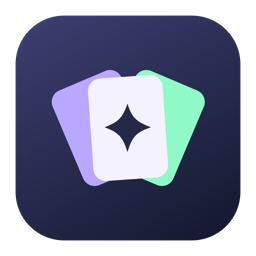
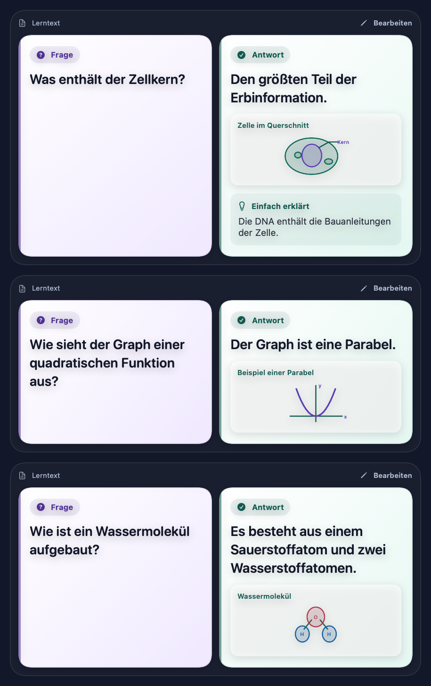

<div align="center">
  
  <h1>Blattkarten</h1>
  <p>Aus Fotos, PDFs und Notizen werden Karteikarten für deinen Mac.</p>
  <p><strong><a href="https://github.com/StrenghtLab/Blattkarten/releases/latest">↓ Blattkarten herunterladen</a></strong> · <a href="#was-blattkarten-kann">Funktionen</a> · <a href="#installation">Installation</a></p>
  <p><sub>macOS 13 Ventura oder neuer · Intel und Apple Silicon</sub></p>
  
</div>

## Was Blattkarten kann

| Erstellen | Organisieren | Lernen |
| --- | --- | --- |
| Fotografiere ein Arbeitsblatt mit der Mac-Kamera, öffne Bilder oder PDFs oder füge Lerntext ein. Das KI-Studio verarbeitet mehrere Dateien und bis zu 60.000 Zeichen. | Blattkarten schlägt ein Fach vor. Du kannst die Auswahl ändern und Karten in eigenen Fächern und verschachtelten Ordnern ablegen. | Drehe Karten um oder tippe deine Antwort ein. Fällige und schwierige Karten kommen zur Wiederholung zurück. |

- **Karten prüfen.** Korrigiere den erkannten Text, klappe Belegstellen auf und wähle aus, welche Karten du speicherst. Passende Rückseiten zeigen Fachskizzen und kurze Erklärungen.
- **Im Stoff nachschlagen.** Suche nach Fragen, Antworten und Dateinamen oder frage den KI-Lernchat nach dem Stoff im geöffneten Fach oder Ordner.
- **Offline arbeiten.** Texterkennung und Schnellmodus laufen auf dem Mac. Für KI-Generierung und Lernchat kannst du Ollama lokal verwenden oder OpenAI einrichten.
- **Auf Papier lernen.** Drucke einen Ordner, ein Fach oder die gesamte Sammlung als faltbare A4-Karten.
- **Lernflamme pflegen.** Sammle Lerntage und schalte Kleidung für deine Flamme frei. Das Schreibtischwidget ist ab macOS 14 verfügbar.

## Installation

1. Lade das aktuelle DMG aus den [GitHub-Releases](https://github.com/StrenghtLab/Blattkarten/releases/latest) herunter.
2. Öffne das DMG und ziehe **Blattkarten** in **Programme**.
3. Öffne die App und wähle **KI-Studio**, um dein erstes Lernmaterial zu importieren.

Die App ist lokal signiert. Eine Apple-Notarisierung steht aus. Über **Blattkarten → Nach Updates suchen …** kannst du prüfen, ob eine neue Version verfügbar ist.

<details>
<summary>KI einrichten und Lernflamme anzeigen</summary>

Für die KI-Generierung wählst du im Studio **Mit KI**. Den Anbieter stellst du im **KI-Lernchat → KI einrichten** ein. Mit Ollama bleiben Anfragen auf dem Mac. Bei OpenAI wird der Lerntext erst nach Bestätigung gesendet. Im Lernchat werden beim Senden die Frage und passende Kartentexte übertragen. Der eingegebene OpenAI-Schlüssel bleibt bis zum Beenden der App im Arbeitsspeicher.

Füge **Lernflamme** in der macOS-Widget-Galerie hinzu. Alternativ öffnet **Lernflamme → Flamme auf dem Schreibtisch anzeigen** eine Schreibtischkarte aus der laufenden App.

</details>

## Lokal bauen

Voraussetzung sind die Xcode Command Line Tools.

```sh
./build.sh
./make-dmg.sh
```

Das erste Skript baut die native App. Das zweite packt ein DMG. GitHub Actions verwendet für Releases die Version aus der `Info.plist`.
